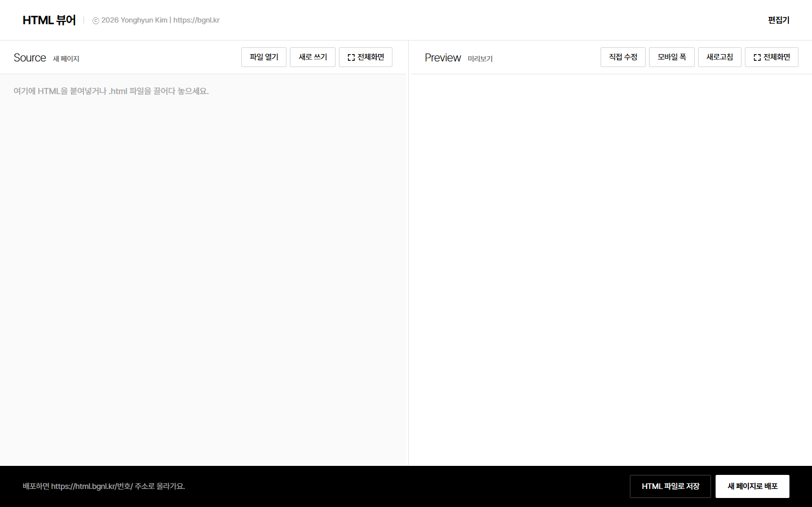

# HTML 뷰어 (htmlviewer)

HTML을 붙여 넣으면 바로 미리보기가 되고, 버튼 하나로 웹 페이지로 올릴 수 있는 편집기입니다. 바이브 코딩 연수나 수업에서 수강생이 만든 HTML을 주소 하나로 나누어 보려고 만들었습니다.

- 편집기: https://html.bgnl.kr/
- 올린 페이지: `https://html.bgnl.kr/1/`, `https://html.bgnl.kr/2/` 처럼 번호가 붙은 주소



배포할 때마다 저장소에 `1/index.html`, `2/index.html` 처럼 번호 폴더가 차례로 커밋되고, GitHub Pages가 그 폴더를 웹 페이지로 보여 줍니다.

## 할 수 있는 일

- **붙여 넣고 바로 보기**: 왼쪽 칸에 HTML을 붙여 넣거나 `.html` 파일을 끌어다 놓으면 오른쪽에 바로 그려집니다. 가운데 막대를 끌어 두 칸 너비를 바꿀 수 있습니다.
- **직접 수정**: 미리보기에서 글자, 서식, 그림을 눌러 바로 고치면 코드에서 그 요소 부분만 바뀝니다. 누른 요소는 코드 칸에서 찾아 강조해 줍니다. 스크립트가 만든 부분은 코드 칸으로 안내합니다.
- **코드와 미리보기 맞추기**: 코드 칸에서 커서를 옮기면 미리보기가 그 요소 쪽으로 스크롤됩니다.
- **모바일 폭, 전체화면**: 미리보기를 휴대폰 폭으로 보거나, 코드 칸과 미리보기 칸을 각각 화면 가득 펼칠 수 있습니다.
- **새 페이지로 배포**: 버튼 하나로 다음 번호 주소에 올립니다. 반영까지 보통 30초에서 2분 걸리고, 다 되면 아래에 링크와 복사 버튼이 나옵니다.
- **방금 만든 페이지 덮어쓰기**: 자기가 방금 만든 페이지는 같은 주소에 다시 올릴 수 있습니다.
- **HTML 파일로 저장**: 지금 코드를 내 컴퓨터에 `.html` 파일로 내려받습니다. 파일 이름은 페이지 제목을 따릅니다.
- **관리자 페이지**: 선생님만 들어가 목록을 보고, 검색하고, 고치고, 지울 수 있습니다.

## 구조

```
수강생 브라우저 ──(HTML)──▶ 중계 서버 (Vercel, 토큰 보관) ──▶ GitHub 저장소 ──▶ GitHub Pages
선생님 브라우저 ──(로그인)─▶ 관리자 페이지 (중계 서버 주소) ──▶ GitHub 저장소
html.bgnl.kr ──(중계)──▶ yhk1m.github.io/htmlviewer/
```

- 수강생 화면에는 토큰이 없습니다. 중계 서버가 대신 커밋하고, 수강생은 **새 페이지 만들기**와 **방금 자기가 만든 페이지 덮어쓰기**만 할 수 있습니다. 덮어쓰기 키는 만든 사람에게만 발급되고, 관리자가 그 페이지를 고치거나 지우면 저절로 무효가 됩니다.
- 관리자 페이지는 배포 페이지와 **다른 주소**(중계 서버)에서 열립니다. 그래서 수강생이 올린 HTML 속 스크립트가 관리자 로그인 정보를 읽을 수 없습니다.
- `html.bgnl.kr`은 Vercel 프로젝트 `htmlviewer-site`(`site/` 폴더)가 GitHub Pages 내용을 그대로 중계하는 주소입니다. `/admin`은 중계 서버의 관리자 페이지로 보냅니다.

## 관리자 페이지

- 주소 끝에 `admin`을 붙여야만 들어갑니다(`https://html.bgnl.kr/admin`). 화면 어디에도 링크가 없습니다.
- 비밀번호(Vercel 환경 변수 `ADMIN_PASSWORD`)로 로그인하면 12시간 유지됩니다. 브라우저에는 토큰을 넣지 않고, 서버가 대신 GitHub에 요청합니다.
- 배포된 페이지가 최신 번호순으로, 각 페이지의 `<title>`이 제목으로 보입니다.
- **검색**(번호, 제목), **수정**(코드와 미리보기, 같은 주소에 덮어쓰기), **삭제와 선택 삭제**를 할 수 있습니다.
- `admin?edit=3`처럼 열면 3번 수정 창이 바로 열립니다.
- 위쪽에 **다음 배포 번호**와 **1번부터 시작** 버튼이 있습니다. 중간에 빈 번호가 있으면 **새 번호**와 **빈 번호** 중에서 다음 배포 번호를 고를 수 있습니다.

## 알아 둘 점

- **번호**: 고유 번호입니다. 한 번 쓴 번호는 페이지를 지워도 다시 쓰지 않습니다. 다음 번호는 저장소의 `counter.json`에 적혀 있고, 수업 중 여러 명이 동시에 눌러도 같은 번호를 두 사람이 받지 않습니다.
- **빈 번호 채우기**: 관리자가 빈 번호를 고르면 다음 배포 1건만 그 번호로 올라가고(누가 배포하든), 그 뒤에는 새 번호로 돌아갑니다. 예전 링크를 가진 사람도 새 페이지를 보게 됩니다.
- **1번부터 시작**: 번호표를 1로 되돌립니다(새 강의를 시작할 때). 남아 있는 페이지 번호는 건너뜁니다.
- 수강생이 올리는 페이지는 `index.html` 하나입니다. 이미지는 외부 주소나 data URI로 넣습니다.
- 저장소가 공개라서 배포된 페이지는 누구나 볼 수 있습니다.
- 번호 폴더(`1/`, `2/` …)는 사용자가 올린 콘텐츠입니다. 편집기를 고칠 때는 루트 파일만 바꿉니다.

## 실행하기

빌드 과정이 없는 정적 파일입니다. 저장소 루트를 정적 서버로 열면 편집기를 볼 수 있습니다.

```
python -m http.server 8000
```

배포는 세 곳으로 나뉩니다.

| 대상 | 방법 |
|---|---|
| 편집기, 관리자 화면, 번호 페이지 | `main` 브랜치에 push 하면 GitHub Pages(루트)에 반영 |
| 중계 서버 `htmlviewer-relay` | `relay/` 폴더에서 `vercel deploy --prod` |
| 대표 주소 `htmlviewer-site` | `site/` 폴더에서 `vercel deploy --prod` |

중계 서버와 루트 파일을 함께 바꿀 때는 중계 서버를 먼저 배포하고 그다음 push 합니다.

### 중계 서버 환경 변수 (Vercel 프로젝트 `htmlviewer-relay`)

| 이름 | 내용 |
|---|---|
| `GITHUB_TOKEN` | Fine-grained 토큰. 저장소 `htmlviewer`만, **Contents: Read and write** |
| `EDIT_SECRET` | 덮어쓰기 키와 관리자 로그인 쿠키 서명용 무작위 문자열 |
| `ADMIN_PASSWORD` | 관리자 페이지 비밀번호 |
| `DEPLOY_CODE` | (선택) 정하면 수강생이 처음 배포할 때 이 강의 코드를 묻습니다 |
| `ALLOWED_ORIGINS` | (선택) 배포를 받을 주소. 기본 `https://html.bgnl.kr,https://yhk1m.github.io` |
| `MAX_BYTES` | (선택) 한 페이지 최대 크기, 기본 2MB |

환경 변수를 바꾼 뒤에는 `relay/` 폴더에서 `vercel deploy --prod`로 다시 배포해야 적용됩니다. 토큰이 만료되면 새로 발급해 `GITHUB_TOKEN`만 바꾸면 됩니다.

## 파일 구성

```
htmlviewer/
├── index.html              편집기 (작성, 미리보기, 배포, 파일로 저장)
├── admin.html              관리자 화면 (목록, 검색, 수정, 삭제, 번호 고르기)
├── config.js               저장소, 대표 주소, 중계 서버 주소 설정
├── core.js                 공통 로직
├── app.css                 공통 스타일
├── visual-edit.js          직접 수정 (parse5 위치 정보로 코드의 그 요소만 바꿈)
├── visual-edit-frame.js    직접 수정의 미리보기 쪽 (postMessage로 편집기와 주고받음)
├── counter.json            다음 배포 번호와 빈 번호 선택
├── 1/, 2/, …               올린 페이지 (번호마다 index.html)
├── relay/                  중계 서버 (Vercel 함수)
│   ├── api/deploy.js       새 페이지 배포
│   ├── api/update.js       방금 만든 페이지 덮어쓰기
│   ├── api/login.js        관리자 로그인
│   ├── api/gh.js           관리자 전용 GitHub 중계
│   └── lib/github.js       GitHub API, 번호표, 키 서명
├── site/                   html.bgnl.kr 앞단 (Vercel rewrite 설정)
└── docs/                   설계 문서와 README 그림
```

## 만든 사람

양정고등학교 지리교사 김용현  
문의: bgnlkim@gmail.com
